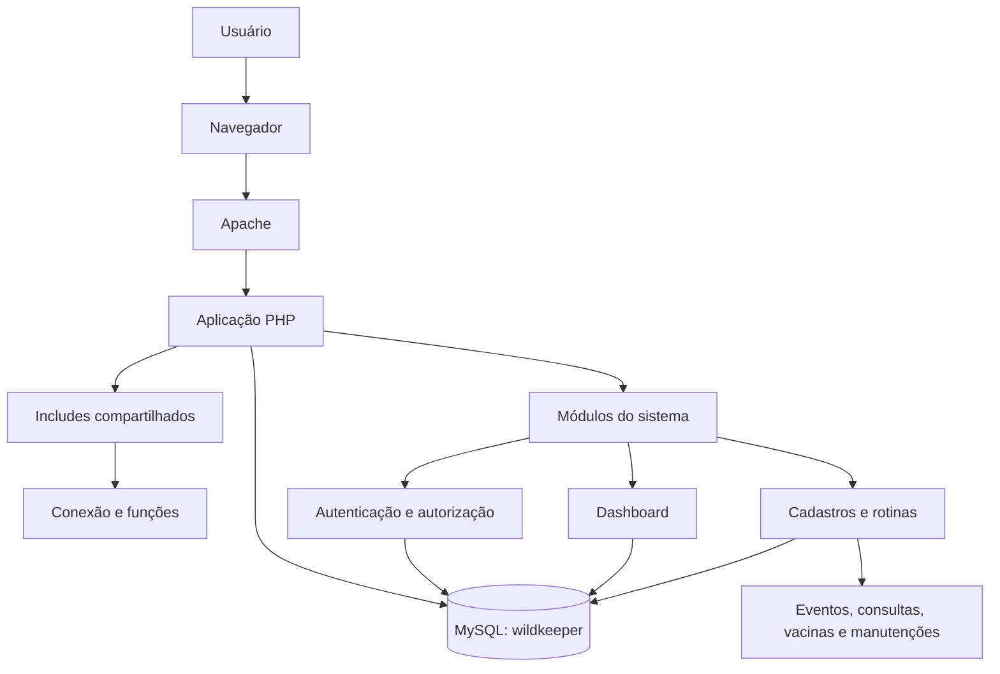

# Diagrama de Arquitetura

O diagrama representa a organização lógica da aplicação no ambiente local. Ele não representa uma arquitetura MVC estrita.

## Componentes

- **Navegador:** apresenta a interface e envia requisições HTTP.
- **Apache:** recebe as requisições e encaminha a execução dos arquivos PHP.
- **Aplicação PHP:** processa regras de negócio, validações e operações.
- **Includes compartilhados:** concentram recursos reutilizados, como conexão, funções, autenticação e navegação.
- **MySQL:** armazena os dados da instituição e dos módulos.

Os detalhes das entidades e dos relacionamentos estão em [Modelo de Dados](modelo-de-dados.md).
