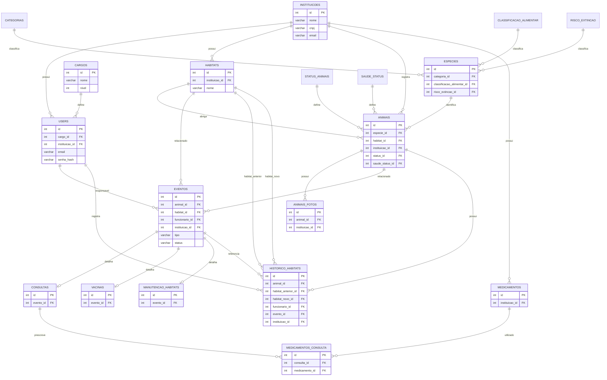

# Modelo de Dados

O diagrama abaixo apresenta as principais entidades e relacionamentos identificados em `banco/script.sql`. É uma visão de alto nível, não substitui a leitura do script SQL para conferir todos os campos, índices e restrições.

## Tabela de controle de tentativas de login

A tabela `login_rate_limits` armazena contadores e períodos de bloqueio. Os identificadores são HMAC binários e não representam diretamente e-mail ou endereço IP.

## Observações

- Espécies e tabelas de classificação são tabelas de referência compartilhadas.
- Dados operacionais são associados à instituição conforme as chaves estrangeiras definidas no banco.
- O tipo do evento determina quais associações devem estar preenchidas.
- A tabela de alimentação não faz parte do modelo atual.
- Para detalhes completos, consultar `banco/script.sql`.
